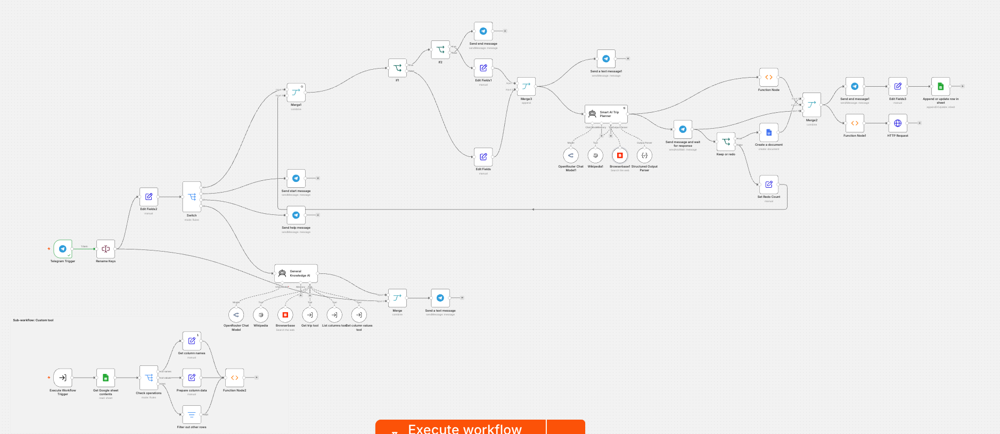

## Course project

Run this repository to host your own Travel AI Assistant

Hosted with:
- N8N Self Hosted with Docker
- Telegram
- OpenRouter (free models)
- BrowserBase (free tier)

See pdf as an example output

## How to run
Run this command (verify contents of start.sh)
```
chmod +x start.sh
```

At first run, do 

```
docker compose up
```

After successfull pull, stop the container

Add following variables in created .env

```
TELEGRAM_BOT_TOKEN=
WEBHOOK_URL=
```

Create bot with BotFather (Telegram), save your token to TELEGRAM_BOT_TOKEN in .env

Run (in later runs, you need to start from this step only)

```
./start.sh
```

Expected output

```
./start.sh       
[+] up 1/1
 ✔ Container n8n-cloudflared-1 Started                           0.1s
Waiting for Cloudflare Tunnel to connect and publish URL...
Generated Tunnel URL: https://xxxxxx.trycloudflare.com
[+] up 3/3
 ✔ Container n8n-sandbox-api-1   Healthy                         6.5s
 ✔ Container n8n-n8n-1           Started                         6.5s
 ✔ Container n8n-sandbox-certs-1 Exited                          0.6s
--------------------------------------------------------
n8n started successfully with WEBHOOK_URL=https://xxxxxx.trycloudflare.com/
--------------------------------------------------------
Registering Webhook with Telegram...
Telegram Response: {"ok":true,"result":true,"description":"Webhook was set"}
```

To have the workflow running, after successfull compose:
- navigate to `AI Trip Planner.json`, 
- copy it contents
- go to http://localhost:5678/
- create workflow 
- Paste it with cmd/ctrl+v

Further configuration requires setting secrects for google drive, google sheets and google docs in google console

## Example



[Link to output file](example.pdf)

[Link to chat example](TelegramChatExportExample/messages.html). You will need to clone the repo and "double click" over it, to see it in browser
